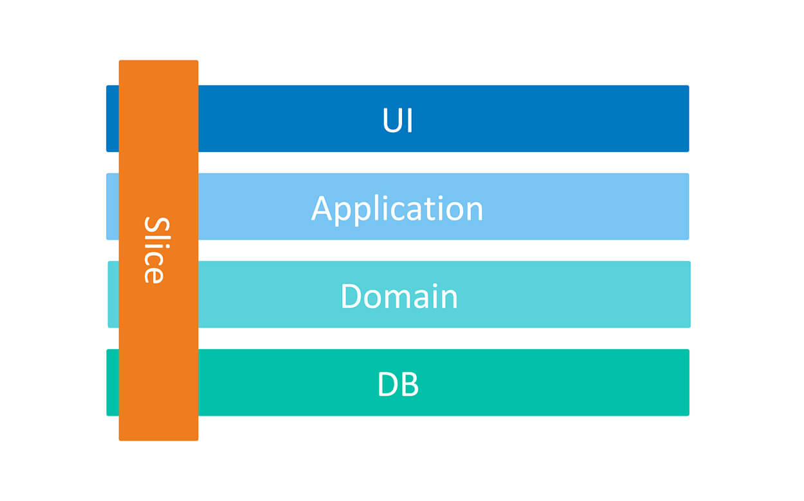
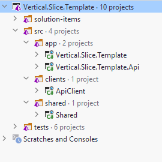
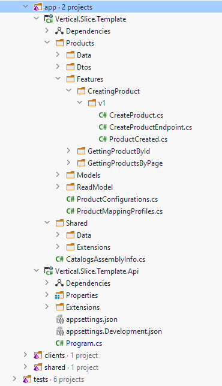

# Vertical Slice API Template

[](https://www.nuget.org/packages/Vertical.Slice.Template)
[](https://github.com/mehdihadeli/vertical-slice-api-template/actions/workflows/build-test.yml)
[](http://commitizen.github.io/cz-cli/)

[](https://codespaces.new/mehdihadeli/vertical-slice-api-template)

> An ASP.NET Core template based on Vertical Slice Architecture, CQRS, Minimal APIs, API versioning, OpenAPI, and .NET Aspire. Create a project from this template by clicking **Use this template** or installing the associated NuGet package.

## ⭐ Support

If you like feel free to ⭐ this repository, It helps out :)

Thanks a bunch for supporting me!

## Table of Contents

- [Vertical Slice API Template](#vertical-slice-api-template)
    - [⭐ Support](#-support)
    - [Table of Contents](#table-of-contents)
    - [Install](#install)
        - [From NuGet](#from-nuget)
        - [From a Local Clone](#from-a-local-clone)
    - [Features](#features)
    - [Libraries and Infrastructure](#libraries-and-infrastructure)
    - [Getting Started](#getting-started)
    - [Setup](#setup)
        - [Dev Certificate](#dev-certificate)
        - [Conventional Commit](#conventional-commit)
    - [Application Structure](#application-structure)
        - [High Level Structure](#high-level-structure)
        - [Modules Structure](#modules-structure)
        - [Folder Structure](#folder-structure)
    - [Vertical Slice Flow](#vertical-slice-flow)
    - [How to Run](#how-to-run)
        - [Using .NET Aspire](#using-net-aspire)
    - [Contribution](#contribution)
    - [License](#license)

## Install

Install the [.NET 10 SDK](https://dotnet.microsoft.com/download/dotnet/10.0) before using the template.

### From NuGet

The template is published on [NuGet.org as Vertical.Slice.Template](https://www.nuget.org/packages/Vertical.Slice.Template). You do not need to clone this repository.

1. Install the latest stable template package:

    ```bash
    dotnet new install Vertical.Slice.Template --nuget-source https://api.nuget.org/v3/index.json
    ```

2. Verify that the template is available with the short name `vsa`:

    ```bash
    dotnet new list vsa
    ```

3. Create a solution in a new folder, replacing `MyProject` with your project name:

    ```bash
    dotnet new vsa -n MyProject -o MyProject
    cd MyProject
    ```

To install a specific version, use `Vertical.Slice.Template@<version>` instead of `Vertical.Slice.Template` in the install command. Replace `<version>` with a version listed on the NuGet package page.

### From a Local Clone

Clone this repository and run these commands from its root:

```bash
dotnet new install .
dotnet new vsa -n <YourProjectName>
```

## Features

- ✅ Using `Vertical Slice Architecture` as a high-level architecture
- ✅ Using `CQRS Pattern` on top of `Mediator` source generation
- ✅ Using `Mapperly` source generator for the mappings
- ✅ Using `Minimal APIs` for handling requests
- ✅ Using PostgreSQL on top of Entity Framework Core
- ✅ Using Wolverine with RabbitMQ for messaging
- ✅ Using .NET Aspire for local orchestration and service discovery
- ✅ Providing generated API clients with Kiota and connected service tooling
- ✅ Using `OpenTelemetry` for collection `logs`, `metrics` and `tracings`
- ✅ Using an OpenTelemetry Collector with Prometheus, Grafana, Loki, and Tempo deployment configurations
- ✅ Using `FluentValidation` and a [validation pipeline behavior](./src/Shared/Validation/RequestValidationBehavior.cs) on top of Mediator
- ✅ Using unit, integration, contract, and end-to-end test projects
- ✅ Using docker and `docker-compose` for deployment

## Libraries and Infrastructure

- ✔️ **[`.NET 10`](https://dotnet.microsoft.com/download/dotnet/10.0)** - .NET runtime and ASP.NET Core target framework
- ✔️ **[`.NET Aspire`](https://learn.microsoft.com/en-us/dotnet/aspire/)** - Local orchestration, service discovery, health checks, and dashboard
- ✔️ **[`Npgsql Entity Framework Core Provider`](https://www.npgsql.org/efcore/)** - Npgsql has an Entity Framework (EF) Core provider. It behaves like other EF Core providers (e.g. SQL Server), so the general EF Core docs apply here as well
- ✔️ **[`FluentValidation`](https://github.com/FluentValidation/FluentValidation)** - Popular .NET validation library for building strongly-typed validation rules
- ✔️ **[`Microsoft.AspNetCore.OpenApi`](https://www.nuget.org/packages/Microsoft.AspNetCore.OpenApi)** - Built-in OpenAPI document generation
- ✔️ **[`Polly`](https://github.com/App-vNext/Polly)** - Polly is a .NET resilience and transient-fault-handling library that allows developers to express policies such as Retry, Circuit Breaker, Timeout, Bulkhead Isolation, and Fallback in a fluent and thread-safe manner
- ✔️ **[`Wolverine`](https://wolverinemod.com/)** - Messaging, handlers, and transactional middleware
- ✔️ **[`Scalar.AspNetCore`](https://github.com/scalar/scalar)** - Interactive OpenAPI reference UI
- ✔️ **[`Scrutor`](https://github.com/khellang/Scrutor)** - Assembly scanning and decoration extensions for Microsoft.Extensions.DependencyInjection
- ✔️ **[`Opentelemetry-dotnet`](https://github.com/open-telemetry/opentelemetry-dotnet)** - The OpenTelemetry .NET Client
- ✔️ **[`Newtonsoft.Json`](https://github.com/JamesNK/Newtonsoft.Json)** - Json.NET is a popular high-performance JSON framework for .NET
- ✔️ **[`AspNetCore.Diagnostics.HealthChecks`](https://github.com/Xabaril/AspNetCore.Diagnostics.HealthChecks)** - Enterprise HealthChecks for ASP.NET Core Diagnostics Package
- ✔️ **[`NSubstitute`](https://github.com/nsubstitute/NSubstitute)** - A friendly substitute for .NET mocking libraries.
- ✔️ **[`StyleCopAnalyzers`](https://github.com/DotNetAnalyzers/StyleCopAnalyzers)** - An implementation of StyleCop rules using the .NET Compiler Platform
- ✔️ **[`Mapperly`](https://github.com/riok/mapperly)** - A .NET source generator for generating object mappings, No runtime reflection.
- ✔️ **[`Mediator`](https://github.com/martinothamar/Mediator)** - A high performance implementation of Mediator pattern in .NET using source generators.
- ✔️ **[`NewID`](https://masstransit.io/documentation/patterns/newid)** - NewId generates sequential unique identifiers that are 128-bit (16-bytes) and fit nicely into a Guid

## Getting Started

1. This application uses `Https` for hosting apis, to setup a valid certificate on your machine, you can create a [Self-Signed Certificate](https://learn.microsoft.com/en-us/aspnet/core/security/docker-https?view=aspnetcore-9.0#macos-or-linux), see more about enforce certificate [here](https://learn.microsoft.com/en-us/aspnet/core/security/enforcing-ssl).
2. Install git - [https://git-scm.com/downloads](https://git-scm.com/downloads).
3. Install the .NET 10 SDK - [https://dotnet.microsoft.com/download/dotnet/10.0](https://dotnet.microsoft.com/download/dotnet/10.0).
4. Install Visual Studio, Rider or VSCode.
5. Run `dotnet new install Vertical.Slice.Template` to install the project templates.
6. Now with running `dotnet new --list`, we should see `Vertical.Slice.Template` in the template list.
7. Create a folder for your solution and cd into it (the template will use it as project name)
8. Run `dotnet new vsa -n <YourProjectName>` for short name or `dotnet new Vertical.Slice.Template -n <YourProjectName>` to create a new project template.
9. Open the generated solution and run `dotnet build` to verify it compiles.
10. Run the API directly from the generated solution:

    ```bash
    dotnet run --project src/App/<YourProjectName>.Api
    ```

11. Open `http://localhost:4000/scalar` for the Scalar API reference or `http://localhost:4000/openapi/v1.json` for the OpenAPI document.

## Setup

### Dev Certificate

This application uses `Https` for hosting apis, to setup a valid certificate on your machine, you can create a [Self-Signed Certificate](https://learn.microsoft.com/en-us/aspnet/core/security/docker-https#macos-or-linux), see more about enforce certificate [here](https://learn.microsoft.com/en-us/dotnet/core/additional-tools/self-signed-certificates-guide) and [here](https://learn.microsoft.com/en-us/aspnet/core/security/enforcing-ssl).

- Setup on windows and [`powershell`](https://learn.microsoft.com/en-us/dotnet/core/additional-tools/self-signed-certificates-guide#with-dotnet-dev-certs):

```powershell
dotnet dev-certs https --clean
dotnet dev-certs https -ep $env:USERPROFILE\.aspnet\https\aspnetapp.pfx -p <CREDENTIAL_PLACEHOLDER>
dotnet dev-certs https --trust
```

- Setup in [`linux and wsl`](https://learn.microsoft.com/en-us/aspnet/core/security/docker-https?view=aspnetcore-7.0#macos-or-linux):

```bash
dotnet dev-certs https --clean
dotnet dev-certs https -ep ${HOME}/.aspnet/https/aspnetapp.pfx -p <CREDENTIAL_PLACEHOLDER>
dotnet dev-certs https --trust
```

`dotnet dev-certs https --trust` is only supported on macOS and Windows. You need to trust certs on Linux in the way that is supported by your distribution. It is likely that you need to trust the certificate in your browser(with this certificate we don't get an exception for https port because of not found certificate but browser shows us this certificate is not trusted).

### Conventional Commit

In this app I use [Conventional Commit](https://www.conventionalcommits.org/en/) and for enforcing its rule I use [conventional-changelog/commitlint](https://github.com/conventional-changelog/commitlint) and [typicode/husky](https://github.com/typicode/husky) with a pre-commit hook. For read more about its setup see [commitlint docs](https://github.com/conventional-changelog/commitlint#getting-started) and [this article](https://betterprogramming.pub/how-to-lint-commit-messages-with-husky-and-commitlint-b51d20a5e514) and [this article](https://www.code4it.dev/blog/conventional-commit-with-githooks).

Here I configured a husky hook for conventional commits:

1. Install NPM:

```text
src
├───App
│   ├───Vertical.Slice.Template          # Catalog domain and vertical slices
│   └───Vertical.Slice.Template.Api      # ASP.NET Core API host
├───ApiClients
│   ├───Vertical.Slice.Template.ConnectedServiceClients
│   └───Vertical.Slice.Template.KiotaClients
├───Aspire
│   ├───Vertical.Slice.Template.AppHost
│   └───Vertical.Slice.Template.ServiceDefaults
└───Shared
    ├───Abstractions
    ├───Cache
    ├───Core
    ├───Diagnostics
    ├───EF
    ├───HealthCheck
    ├───Logging
    ├───Messaging.Wolverine
    ├───OpenApi
    ├───RateLimit
    ├───Resiliency
    ├───Validation
    └───Web
```

## Application Structure

In this project I used [vertical slice architecture](https://jimmybogard.com/vertical-slice-architecture/) or [Restructuring to a Vertical Slice Architecture](https://codeopinion.com/restructuring-to-a-vertical-slice-architecture/) also I used [feature folder structure](http://www.kamilgrzybek.com/design/feature-folders/) in this project.

- We treat each request as a distinct use case or slice, encapsulating and grouping all concerns from front-end to back.
- When We adding or changing a feature in an application in n-tire architecture, we are typically touching many different "layers" in an application. we are changing the user interface, adding fields to models, modifying validation, and so on. Instead of coupling across a layer, we couple vertically along a slice and each change affects only one slice.
- We `Minimize coupling` `between slices`, and `maximize coupling` `in a slice`.
- With this approach, each of our vertical slices can decide for itself how to best fulfill the request. New features only add code, we're not changing shared code and worrying about side effects. For implementing vertical slice architecture using cqrs pattern is a good match.




Also here I used [CQRS](https://www.eventecommerce.com/cqrs-pattern) for decompose my features to very small parts that makes our application:

- maximize performance, scalability and simplicity.
- adding new feature to this mechanism is very easy without any breaking change in other part of our codes. New features only add code, we're not changing shared code and worrying about side effects.
- easy to maintain and any changes only affect on one command or query (or a slice) and avoid any breaking changes on other parts
- it gives us better separation of concerns and cross cutting concern (with help of Mediator behavior pipelines) in our code instead of a big service class for doing a lot of things.

With using [CQRS](https://event-driven.io/en/cqrs_facts_and_myths_explained/), our code will be more aligned with [SOLID principles](https://en.wikipedia.org/wiki/SOLID), especially with:

- [Single Responsibility](https://en.wikipedia.org/wiki/Single-responsibility_principle) rule - because logic responsible for a given operation is enclosed in its own type.
- [Open-Closed](https://en.wikipedia.org/wiki/Open%E2%80%93closed_principle) rule - because to add new operation you don’t need to edit any of the existing types, instead you need to add a new file with a new type representing that operation.

Here instead of some [Technical Splitting](http://www.kamilgrzybek.com/design/feature-folders/) for example a folder or layer for our `services`, `controllers` and `data models` which increase dependencies between our technical splitting and also jump between layers or folders, We cut each business functionality into some vertical slices, and inner each of these slices we have [Technical Folders Structure](http://www.kamilgrzybek.com/design/feature-folders/) specific to that feature (command, handlers, infrastructure, repository, controllers, data models, ...).

Usually, when we work on a given functionality we need some technical things for example:

- API endpoint (Controller)
- Request Input (Dto)
- Request Output (Dto)
- Some class to handle Request, For example Command and Command Handler or Query and Query Handler
- Data Model

Now we could all of these things beside each other and it decrease jumping and dependencies between some layers or folders.

Keeping such a split works great with CQRS. It segregates our operations and slices the application code vertically instead of horizontally. In Our CQRS pattern each command/query handler is a separate slice. This is where you can reduce coupling between layers. Each handler can be a separated code unit, even copy/pasted. Thanks to that, we can tune down the specific method to not follow general conventions (e.g. use custom SQL query or even different storage). In a traditional layered architecture, when we change the core generic mechanism in one layer, it can impact all methods.

### High Level Structure



### Modules Structure



### Folder Structure

```text
src
├───App
│   ├───Vertical.Slice.Template          # Catalog domain and vertical slices
│   └───Vertical.Slice.Template.Api      # ASP.NET Core API host
├───ApiClients
│   ├───Vertical.Slice.Template.ConnectedServiceClients
│   └───Vertical.Slice.Template.KiotaClients
├───Aspire
│   ├───Vertical.Slice.Template.AppHost
│   └───Vertical.Slice.Template.ServiceDefaults
└───Shared
    ├───Abstractions
    ├───Cache
    ├───Core
    ├───Diagnostics
    ├───EF
    ├───HealthCheck
    ├───Logging
    ├───Messaging.Wolverine
    ├───OpenApi
    ├───RateLimit
    ├───Resiliency
    ├───Validation
    └───Web
```

## Vertical Slice Flow

Each feature groups its request, handler, endpoint, DTOs, mapping, and persistence concerns under the feature area. Shared cross-cutting behavior lives in `src/Shared`; hosting and orchestration live in `src/App` and `src/Aspire`.

## How to Run

Open `Vertical.Slice.Template.sln` in Visual Studio, Rider, or VS Code and run the Aspire AppHost for the complete local environment.

### Using .NET Aspire

The Aspire AppHost starts the API together with PostgreSQL 17 and RabbitMQ 4. It also provides service discovery, health checks, and the Aspire dashboard.

From the repository root, run:

```bash
dotnet run --project src/Aspire/Vertical.Slice.Template.AppHost
```

Use the dashboard URL printed by Aspire to inspect resources, logs, traces, and health. The API resource is registered as `catalogs-api`; the database and broker resources are registered as `catalogsdb` and `rabbitmq`.

To run only the API without Aspire infrastructure, use:

```bash
dotnet run --project src/App/Vertical.Slice.Template.Api
```

## Contribution

The application is in development status. You are feel free to submit pull request or create the issue.

## License

The project is under [MIT license](https://github.com/mehdihadeli/vertical-slice-api-template/blob/main/LICENSE).
